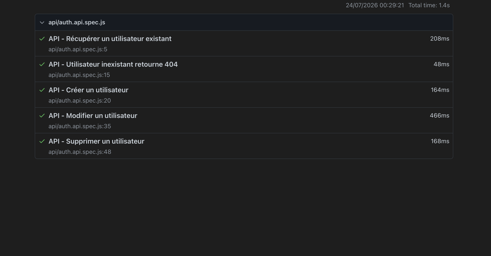

# OrangeHRM QA Automation


## Project Overview

This project demonstrates a complete QA Automation framework built with Playwright.

It includes:

- End-to-End (E2E) tests for the OrangeHRM demo application
- API tests using JSONPlaceholder
- Page Object Model (POM)
- Continuous Integration with GitHub Actions
- HTML test reports

The goal of this project is to showcase industry-standard QA Automation practices and serve as a portfolio project.

---

## Tech Stack

- JavaScript
- Playwright
- Playwright API Testing
- Page Object Model (POM)
- Git & GitHub
- GitHub Actions (CI/CD)
- HTML Reporter

---

## Project Structure

```text
orangehrm-qa-automation
│
├── .github/
│   └── workflows/
│       └── playwright.yml
│
├── tests/
│   ├── api/
│   │   └── auth.api.spec.js
│   │
│   ├── pages/
│   │   ├── LoginPage.js
│   │   └── DashboardPage.js
│   │
│   ├── login.spec.js
│   └── dashboard.spec.js
│
├── playwright.config.js
├── package.json
└── README.md
```

---

## Test Coverage

### End-to-End Tests (OrangeHRM)

- Login with valid credentials
- Login with invalid password
- Login with empty fields
- Dashboard title verification
- Dashboard widget visibility
- Navigation menu visibility

### API Tests (JSONPlaceholder)

- Get an existing user
- Get a non-existing user
- Create a new user
- Update a user
- Delete a user

---

## Run the Project Locally

Clone the repository:

```bash
git clone https://github.com/Ashawir/orangehrm-qa-automation.git
```

Install dependencies:

```bash
npm install
```

Install Playwright browsers:

```bash
npx playwright install
```

Run all tests:

```bash
npm test
```

Open the HTML report:

```bash
npx playwright show-report
```

---

### Run smoke tests only

Critical tests are tagged with `@smoke`. To run only these:

```bash
npm run test:smoke
```

---

## Continuous Integration

This project uses GitHub Actions to automatically execute all Playwright tests on every push to the repository.

Current test suite:

- ✅ 6 End-to-End tests
- ✅ 5 API tests

**Total: 11 automated tests**

---

## HTML Report

The project generates a Playwright HTML report after each test execution.

Screenshot of the generated report:


---

## Author

Developed by **Andhume** as part of a QA Automation learning journey.